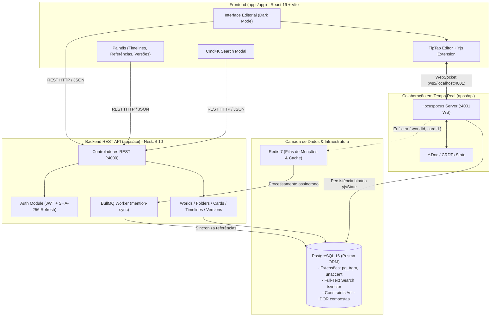

# 🌌 Worldbuilding Platform (`worldbuilding-platform`)

> **Workspace privado, imersivo e de alta fidelidade editorial para autores de ficção e mestres de RPG organizarem lore, cronologias, referências cruzadas e documentos colaborativos em tempo real.**

Inspirado na sofisticação e no acabamento visual da [vvd.world](https://vvd.world), o projeto foi projetado para uso estritamente pessoal e em grupo fechado: estruturar mundos fantásticos ou de ficção científica, documentar entidades e facções, vincular referências cruzadas, realizar buscas instantâneas e navegar por cronologias históricas.

---

> [!IMPORTANT]
> **Escopo e Limites do Workspace:**
> Este é um workspace **estritamente privado**. O projeto não implementa Wiki Pública, Mapas/Zonas interativos ou publicação aberta para a web, concentrando 100% de seus recursos na excelência de escrita, colaboração em tempo real via CRDTs, busca ponderada, integridade relacional e linhas do tempo históricas.

---

## 📑 Sumário

- [Visão Geral da Stack](#-visão-geral-da-stack)
- [Funcionalidades e Módulos](#-funcionalidades-e-módulos)
- [Arquitetura do Sistema](#-arquitetura-do-sistema)
- [Pré-requisitos](#-pré-requisitos)
- [Setup e Execução](#-setup-e-execução-passo-a-passo)
- [Proteção de Dados, Backups e Recuperação](#-proteção-de-dados-backups-e-recuperação)
- [Referência de Endpoints da API](#-referência-de-endpoints-da-api)
- [Estrutura do Monorepo](#-estrutura-do-monorepo)
- [Comandos Principais](#-comandos-principais)
- [Diretrizes de Desenvolvimento (AGENTS.md)](#-diretrizes-de-desenvolvimento)

---

## ⚡ Visão Geral da Stack

| Camada | Tecnologias Utilizadas |
| :--- | :--- |
| **Monorepo** | [Turborepo 2](https://turbo.build/) + [pnpm Workspaces 10](https://pnpm.io/) |
| **Backend API** | [NestJS 10](https://nestjs.com/) (TypeScript Strict, Fastify/Express, BullMQ) |
| **Colaboração em Tempo Real** | [Hocuspocus Server](https://tiptap.dev/docs/hocuspocus) + [Yjs](https://yjs.dev/) (CRDTs com WebSockets) |
| **Frontend Workspace** | [React 19](https://react.dev/) + [Vite](https://vite.dev/) + [TipTap](https://tiptap.dev/) |
| **Banco de Dados & ORM** | [PostgreSQL 16](https://www.postgresql.org/) + [Prisma ORM](https://www.prisma.io/) (`pg_trgm`, `unaccent`) |
| **Filas e Cache** | [Redis 7](https://redis.io/) + [BullMQ](https://docs.bullmq.io/) |
| **Estilização** | CSS Modules / Vanilla CSS com tema escuro editorial, tipografia serifada e suporte a `prefers-reduced-motion` |

---

## ✨ Funcionalidades e Módulos

### 1. ✍️ Editor Colaborativo em Tempo Real (CRDTs)
- **Persistência Conflito-Zero:** Sincronização via Yjs e servidor WebSocket dedicado Hocuspocus na porta `4001`. Os documentos armazenam tanto o estado binário do Yjs (`yjsState`) quanto representações em JSON e texto puro.
- **Awareness de Usuários:** Indicadores visuais e cursores multi-usuário com nomes e avatares customizados.
- **Extensões Customizadas TipTap:**
  - `@menção`: Autocomplete dinâmico e menção a outros cards de lore com navegação instantânea.
  - `||spoiler||`: Texto protegido com desfoque e revelação sob clique.
  - `:::secret` (`HiddenBlock`): Blocos de anotações confidenciais desenhados especificamente para Mestres/DMs.

### 2. 🔎 Busca Global Instantânea (`Cmd+K` / `Ctrl+K`)
- **Paleta de Comando:** Modal acessível via atalho global de teclado em qualquer ponto do workspace.
- **PostgreSQL Full-Text Search com Pesos:** Busca com ranking ponderado via `tsvector` (`A` para título, `B` para aliases, `C` para conteúdo em texto puro).
- **Tolerância a Erros e Acentos:** Trigramas com extensão `pg_trgm` e normalização com `unaccent` para resultados fonéticos precisos mesmo com termos parciais ou sem acentos.
- **Navegação por Teclado:** Salto direto para o editor ou painéis específicos com preview contextual dos resultados.

### 3. 🗂️ Organização Hierárquica e Cards de Lore
- **Árvore de Pastas Aninhadas:** Pastas com profundidade livre, ícones, cores e ordenação manual (`sortOrder`).
- **Regra de Exclusividade Rígida:** Um card de lore pertence a uma pasta OU é filho de outro card, nunca ambos (assegurado por constraint `CHECK` no PostgreSQL).
- **Prevenção Algorítmica de Ciclos:** Validação com CTEs recursivas no Postgres que impede hierarquias cíclicas (`A -> B -> A`).
- **Soft-Delete em Cascata:** Exclusão lógica (`deletedAt`) que propaga recursivamente a ocultação de todos os cards descendentes.

### 4. 🗑️ Lixeira e Recuperação de Conteúdo (Trash)
- Painel centralizado que lista todas as pastas e cards enviados para a lixeira.
- Restauração com validação de integridade referencial, reativando a cadeia hierárquica associada.

### 5. ⏳ Linhas do Tempo & Eventos Históricos
- Suporte a múltiplas linhas do tempo cronológicas por mundo.
- **Datas Fictícias Flexíveis (`dateText`):** Aceita qualquer notação de calendário de ficção (ex: *"Ano 340 da 2ª Era"*, *"Era dos Dragões - Mês 4"*).
- **Vínculo Direto a Cards de Lore:** Associação opcional de eventos históricos com cards do mundo, permitindo saltar diretamente para a documentação da entidade ou batalha relacionada.

### 6. 🔗 Grafo de Referências Cruzadas (Backlinks)
- Extração assíncrona de menções executada em segundo plano através de workers BullMQ.
- Painel lateral que inspeciona o card atual e cataloga:
  - **Referências de Saída:** Links para outros cards presentes no documento.
  - **Backlinks (Referências de Entrada):** Outros artigos que citam o card atual.
  - **Menções Quebradas:** Detecção automática de links apontando para cards excluídos ou inexistentes.

### 7. 🕒 Histórico de Versões e Checkpoints
- Gravação manual de pontos de restauração (`DocumentVersion`) com rótulo descritivo (ex: *"Antes da Batalha dos Três Picos"*).
- Visualização cronológica com timestamp, autor, contagem de palavras e pré-visualização completa do conteúdo.
- **Restauração com Snapshot de Segurança:** Ao restaurar uma versão prévia, o sistema cria automaticamente um backup preventivo do estado atual do documento antes de aplicar o rollback.

### 8. 🛡️ Segurança Multi-tenancy & Anti-IDOR
- **Proteção Anti-IDOR Rígida:** Todas as operações que buscam ou alteram entidades filtram obrigatoriamente por `id` **E** `worldId`, com chaves únicas compostas `@@unique([id, worldId])` no banco de dados.
- **Sessões e Tokens:** `refreshToken` armazenado exclusivamente como hash SHA-256 e rotacionado a cada novo refresh (destruição imediata da sessão anterior).
- **RBAC por Mundo:** Papéis granulares (`OWNER`, `ADMIN`, `EDITOR`, `VIEWER`).

---

## 🏛️ Arquitetura do Sistema



---

## 📋 Pré-requisitos

Certifique-se de ter instalado em seu ambiente:

- **Node.js**: Versão `20.x` ou `22.x` (LTS recomendada).
- **pnpm**: Versão `10.x` (o repositório está fixado em `pnpm@10.34.4`).
- **Docker & Docker Compose**: Para execução dos contêineres locais do PostgreSQL 16 e Redis 7.
- **Git**: Para versionamento de código.
- **PowerShell** *(no Windows)*: Para execução automatizada dos scripts de backup e restore.

---

## 🚀 Setup e Execução (Passo a Passo)

### 1. Clonar o Repositório e Instalar Dependências

```bash
git clone <URL_DO_REPOSITORIO>
cd Projeto_RPGs
pnpm install
```

### 2. Configurar Variáveis de Ambiente

Copie o arquivo `.env.example` para `.env` na raiz do projeto e nos pacotes internos:

```bash
# Na raiz:
cp .env.example .env

# Sincronizar nos pacotes da API e do banco de dados:
cp .env.example apps/api/.env
cp .env.example packages/database/.env
```

> [!TIP]
> Caso esteja no Windows PowerShell, utilize:
> ```powershell
> Copy-Item .env.example .env
> Copy-Item .env.example apps/api/.env
> Copy-Item .env.example packages/database/.env
> ```

### 3. Subir a Infraestrutura (PostgreSQL e Redis)

Inicie os contêineres do Docker em segundo plano:

```bash
docker compose up -d
```

Para verificar se os contêineres estão saudáveis:

```bash
docker compose ps
```

### 4. Executar as Migrações do Banco de Dados

Aplique as migrações no PostgreSQL e gere os clientes tipados do Prisma:

```bash
# Executa migrações pendentes no Postgres
pnpm db:migrate

# Gera o Prisma Client com tipos estritos
pnpm db:generate
```

*(Opcional)* Para inspecionar visualmente o banco de dados pelo navegador:

```bash
pnpm db:studio
```
Acesse o Prisma Studio em [http://localhost:5555](http://localhost:5555).

### 5. Iniciar o Ambiente de Desenvolvimento

Para rodar simultaneamente toda a stack (Frontend, API REST e Servidor Hocuspocus) com hot-reload:

```bash
pnpm dev
```

Ou execute separadamente por pacote em terminais dedicados:

```bash
# Terminal 1 — Backend API e Hocuspocus:
pnpm --filter @proj/api dev

# Terminal 2 — Frontend SPA (Vite):
pnpm --filter @proj/app dev
```

### Endereços de Acesso Local

| Serviço | URL | Descrição |
| :--- | :--- | :--- |
| **Workspace Web (Frontend)** | [http://localhost:3000](http://localhost:3000) | Interface gráfica editorial do usuário |
| **Backend REST API** | [http://localhost:4000](http://localhost:4000) | Endpoints e documentação REST |
| **Hocuspocus Server** | `ws://localhost:4001` | WebSocket para colaboração CRDT em tempo real |
| **Prisma Studio** | [http://localhost:5555](http://localhost:5555) | Interface web para visualização de tabelas e dados |

---

## 🛡️ Proteção de Dados, Backups e Recuperação

O projeto conta com scripts dedicados e compatíveis com contêineres Docker para garantir a segurança dos dados de lore:

### Criar Backup do Banco de Dados

Gera um arquivo binário comprimido `.dump` na pasta `backups/`:

```bash
pnpm db:backup
```

Ou diretamente via PowerShell:
```powershell
powershell -ExecutionPolicy Bypass -File ./scripts/backup.ps1
```

### Restaurar Backup

Para restaurar o snapshot mais recente gerado automaticamente:

```bash
pnpm db:restore
```

Ou para restaurar um arquivo específico:

```powershell
powershell -ExecutionPolicy Bypass -File ./scripts/restore.ps1 -BackupFile ./backups/worldbuilding_backup_YYYYMMDD_HHMMSS.dump
```

> [!NOTE]
> Os scripts detectam automaticamente se o PostgreSQL está rodando via contêiner Docker (`worldbuilding_postgres`) ou localmente via binários nativos (`pg_dump` / `pg_restore`).

---

## 📡 Referência de Endpoints da API

Todas as rotas de mundo exigem autenticação via Bearer JWT e validam o papel do usuário no mundo (`WorldRoleGuard`).

### Autenticação & Sessões
| Método | Rota | Descrição |
| :--- | :--- | :--- |
| `POST` | `/api/auth/register` | Criação de novo usuário com e-mail e senha |
| `POST` | `/api/auth/login` | Login com e-mail/senha, emitindo tokens de acesso e refresh |
| `POST` | `/api/auth/refresh` | Rotação atômica de refresh token com invalidação imediata do anterior |

### Mundos (Worlds)
| Método | Rota | Descrição |
| :--- | :--- | :--- |
| `POST` | `/api/worlds` | Criação de um novo mundo |
| `GET` | `/api/worlds` | Listagem dos mundos dos quais o usuário participa |
| `GET` | `/api/worlds/:id` | Detalhes de um mundo específico |
| `PATCH` | `/api/worlds/:id` | Atualização de metadados do mundo |
| `DELETE` | `/api/worlds/:id` | Soft-delete do mundo |

### Pastas (Folders)
| Método | Rota | Descrição |
| :--- | :--- | :--- |
| `POST` | `/api/worlds/:worldId/folders` | Criação de pasta na árvore |
| `GET` | `/api/worlds/:worldId/folders` | Listagem plana de pastas |
| `GET` | `/api/worlds/:worldId/folders/tree` | Árvore hierárquica aninhada de pastas |
| `PATCH` | `/api/worlds/:worldId/folders/:id` | Atualização de dados da pasta |
| `PATCH` | `/api/worlds/:worldId/folders/:id/move` | Mover pasta com prevenção estrita de ciclos |
| `DELETE` | `/api/worlds/:worldId/folders/:id` | Soft-delete da pasta e filhos |

### Cards de Lore
| Método | Rota | Descrição |
| :--- | :--- | :--- |
| `POST` | `/api/worlds/:worldId/cards` | Criação de card (obedece regra de exclusividade pasta XOR pai) |
| `GET` | `/api/worlds/:worldId/cards` | Listagem de cards de lore |
| `GET` | `/api/worlds/:worldId/cards/:id` | Obtenção do card e de seu documento vinculado |
| `PATCH` | `/api/worlds/:worldId/cards/:id` | Atualização de metadados e propriedades |
| `DELETE` | `/api/worlds/:worldId/cards/:id` | Soft-delete do card com efeito em cascata |
| `GET` | `/api/worlds/:worldId/cards/:id/references` | Backlinks e referências cruzadas ativas/quebradas |

### Checkpoints e Histórico de Versões
| Método | Rota | Descrição |
| :--- | :--- | :--- |
| `POST` | `/api/worlds/:worldId/cards/:cardId/versions` | Gravação manual de ponto de restauração com label |
| `GET` | `/api/worlds/:worldId/cards/:cardId/versions` | Listagem cronológica de checkpoints do card |
| `GET` | `/api/worlds/:worldId/cards/:cardId/versions/:versionId` | Detalhes e snapshot de conteúdo da versão |
| `POST` | `/api/worlds/:worldId/cards/:cardId/versions/:versionId/restore` | Restauração da versão com backup prévio automático |

### Linhas do Tempo (Timelines) & Eventos
| Método | Rota | Descrição |
| :--- | :--- | :--- |
| `POST` | `/api/worlds/:worldId/timelines` | Criação de linha do tempo |
| `GET` | `/api/worlds/:worldId/timelines` | Listagem de linhas do tempo do mundo |
| `GET` | `/api/worlds/:worldId/timelines/:id` | Detalhes da linha do tempo com seus eventos |
| `POST` | `/api/worlds/:worldId/timelines/:id/events` | Criação de evento histórico com `dateText` e card vinculado |
| `PATCH` | `/api/worlds/:worldId/timelines/:id/events/:eventId` | Atualização de evento histórico |
| `DELETE` | `/api/worlds/:worldId/timelines/:id/events/:eventId` | Remoção de evento da linha do tempo |

### Busca Global & Lixeira
| Método | Rota | Descrição |
| :--- | :--- | :--- |
| `GET` | `/api/worlds/:worldId/search?q=...` | Busca ponderada FTS com tolerância fonética (`pg_trgm`) |
| `GET` | `/api/worlds/:worldId/trash` | Listagem de registros excluídos |
| `POST` | `/api/worlds/:worldId/trash/restore` | Restauração de itens da lixeira |

---

## 📁 Estrutura do Monorepo

```text
Projeto_RPGs/
├── apps/
│   ├── api/                          # Backend REST + Hocuspocus Server (NestJS 10)
│   │   ├── src/
│   │   │   ├── auth/                 # Autenticação JWT, guards e refresh tokens em SHA-256
│   │   │   ├── card-types/           # Tipagem customizável de cards e schemas de propriedades
│   │   │   ├── cards/                # CRUD de cards com CTE recursiva e soft-delete
│   │   │   ├── folders/              # Pastas aninhadas em árvore com prevenção de ciclos
│   │   │   ├── prisma/               # Serviço de conexão e injeção do Prisma
│   │   │   ├── realtime/             # Provedor Hocuspocus WebSocket e workers BullMQ de menções
│   │   │   ├── search/               # Busca full-text ponderada e similaridade de trigramas
│   │   │   ├── timelines/            # Módulo de linhas do tempo e eventos históricos
│   │   │   ├── trash/                # Módulo de recuperação de entidades deletadas (Trash)
│   │   │   ├── versions/             # Histórico de versões e restauração com snapshot seguro
│   │   │   └── worlds/               # Gestão de mundos, membros e papéis (Anti-IDOR)
│   │   └── test/                     # Testes ponta a ponta (e2e)
│   │
│   └── app/                          # Frontend SPA Editorial (React 19 + Vite)
│       ├── src/
│       │   ├── components/           # Componentes visuais (WorldEditor, Sidebar, CmdkSearch, etc.)
│       │   ├── extensions/           # Extensões TipTap (Mention, Spoiler, HiddenBlock)
│       │   ├── hooks/                # Hooks reativos (useSidebarTree, useSearch, etc.)
│       │   ├── lib/                  # Utilitários de API e clientes HTTP
│       │   └── styles/               # CSS global, design tokens e suporte a acessibilidade
│
├── packages/
│   ├── database/                     # Schema Prisma centralizado, migrations SQL e seeds
│   └── shared/                       # Tipos TypeScript, sanitizadores e extratores de texto
│
├── docs/                             # Registros de decisões de arquitetura (DECISIONS.md)
├── scripts/                          # Automação de backups e restaurações (PowerShell)
├── docker-compose.yml                # Serviços do PostgreSQL 16 e Redis 7
├── AGENTS.md                         # Regras e padrões mandatórios de desenvolvimento
├── turbo.json                        # Configuração de pipelines do Turborepo
└── package.json                      # Scripts e dependências raiz
```

---

## 🛠️ Comandos Principais

| Comando | Descrição |
| :--- | :--- |
| `pnpm dev` | Inicia Frontend, API REST e Hocuspocus em modo watch com hot-reload |
| `pnpm build` | Compila todos os pacotes e aplicações via Turborepo (`turbo run build`) |
| `pnpm lint` | Executa verificação estrita de tipos TypeScript sem emitir arquivos (`tsc --noEmit`) |
| `pnpm test` | Roda a suíte completa de testes unitários em todos os pacotes |
| `pnpm test:e2e` | Roda os testes de integração ponta a ponta na API (`apps/api`) |
| `pnpm db:migrate` | Executa as migrações SQL pendentes no PostgreSQL |
| `pnpm db:generate` | Regenera o cliente Prisma com os tipos tipados |
| `pnpm db:studio` | Abre a interface visual do Prisma Studio em `http://localhost:5555` |
| `pnpm db:backup` | Cria um snapshot compactado `.dump` do banco de dados na pasta `backups/` |
| `pnpm db:restore` | Restaura o backup mais recente para o banco de dados |

---

## 📐 Diretrizes de Desenvolvimento

Ao contribuir ou estender a plataforma, consulte as regras inegociáveis detalhadas no arquivo [`AGENTS.md`](./AGENTS.md):

1. **Anti-IDOR Mandatório (Multi-tenancy):** Qualquer consulta a entidades vinculadas a um mundo DEVE filtrar obrigatoriamente por `id` e `worldId` (ex: `where: { id: cardId, worldId }`).
2. **Exclusividade de Cards:** Um card pertence a uma pasta OU é filho de outro card, nunca ambos simultaneamente (`check_folder_xor_parent_card`).
3. **Autenticação Segura:** `refreshToken` NUNCA é mantido em texto puro; é persistido como hash SHA-256 e rotacionado a cada uso.
4. **Fila de Menções sem Bloqueio:** O editor enfileira apenas o par identificador `{ worldId, cardId }`. O worker carrega o documento mais recente diretamente do banco de dados (não passar payloads pesados de JSON pelo Redis).
5. **Triggers Otimizados:** O trigger do PostgreSQL para atualizar o vetor de busca em `documents` só executa quando `plainText` é realmente alterado.
